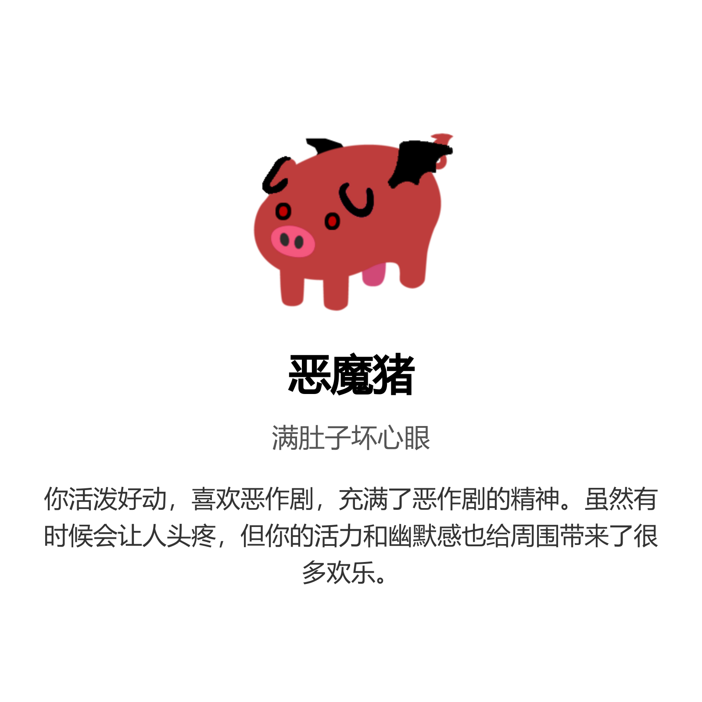
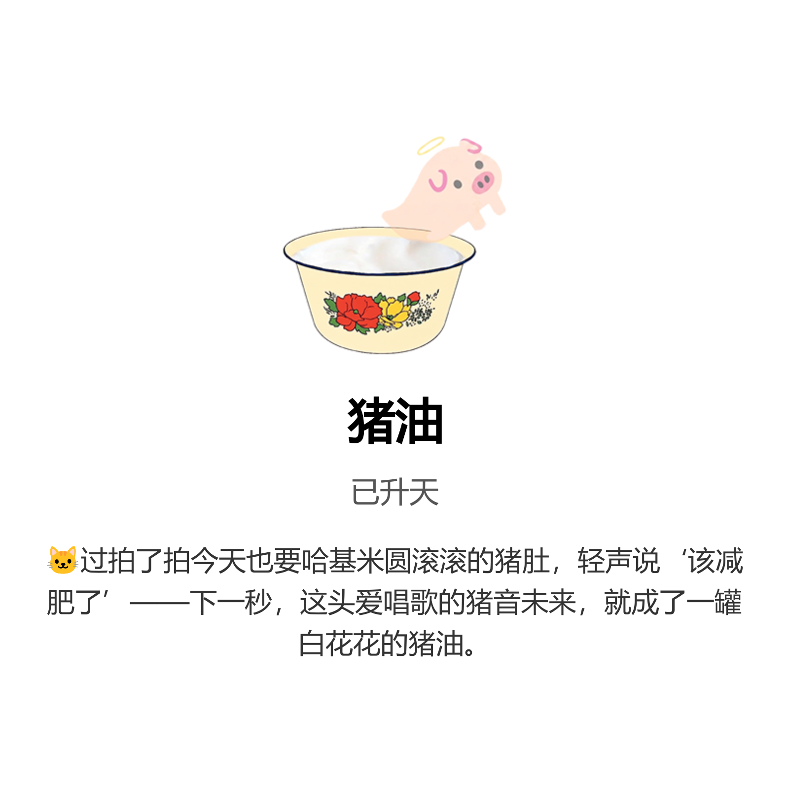
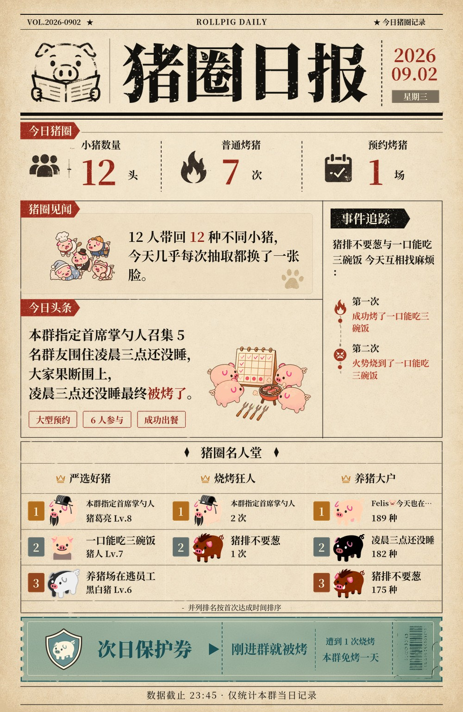
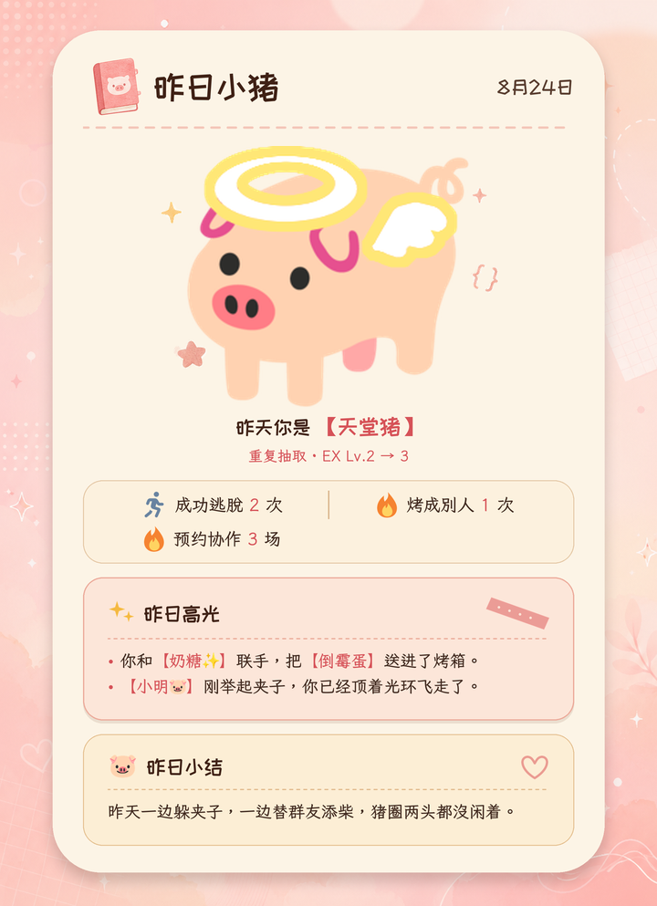

<div align="center">
  

  <h1>🐖 RollPig Plus 🐖</h1>

  <p><strong>围绕「今日小猪」的 NoneBot 群聊收集、成长与互动插件</strong></p>
  <p>每天抽一只属于你的小猪，慢慢养成属于自己的猪圈吧！也可以把群友烤了~</p>

  <p>
    = 3.10">
    = 2.4">
    
    <a href="LICENSE"></a>
  </p>

  <p>
    <a href="#-快速开始">快速开始</a> |
    <a href="#-主要功能">主要功能</a> |
    <a href="#-功能概览">功能概览</a> |
    <a href="#️-常用指令">常用指令</a> |
    <a href="#️-配置">配置</a> |
    <a href="#-资源与扩展">资源与扩展</a>
  </p>
</div>

> RollPig Plus 最初基于 [Bearlele/nonebot-plugin-rollpig](https://github.com/Bearlele/nonebot-plugin-rollpig) 开发。  
> 本项目在保留「每天抽一只小猪」核心功能的基础上，继续扩展了图鉴成长、EX Lv.、烤群友、日报、EX 差分资源与多 Bot 状态同步等能力。

> 原版 [RollPig](https://github.com/Bearlele/nonebot-plugin-rollpig) 现已完成重构并支持 GIF 小猪，同时接入 RollPig 公共资源同步，可持续获取每月更新的完整小猪资源。
> 如果只需要轻量的「今日小猪 / 随机小猪 / 找猪」体验，可以直接使用原版。

## ✨ 效果预览

| 今日小猪 | 小猪图鉴 | 烤群友 |
| --- | --- | --- |
|  |  |  |

## 🐷 主要功能

| 模块 | 能做什么 |
| --- | --- |
| **今日小猪** | 每天抽取一只固定小猪；支持昨日回顾、明日预测、随机小猪和 PigHub 找猪。 |
| **猪圈成长** | 收藏小猪、查看图片图鉴；重复抽取和每日一次烤猪加餐会提升 EX Lv.，并逐步触发新猪保底。 |
| **EX 差分** | 资源包可为同一只猪提供不同 EX 等级的立绘和文案，不新增图鉴 ID，也不破坏已有成长数据。 |
| **烤猪互动** | 今日烤猪、烤群友、随机烤猪、加急生火、预约烤猪、聚众烤猪与烤箱续火。 |
| **群聊总结** | 支持个人昨日回顾、本周小猪长图，以及群聊猪圈日报主动查卡与每日定时推送。 |
| **云端资源** | 公有小猪、GIF Overlay、EX 差分和共享烤猪文案可在线增量同步；失败时保留当前可用资源。 |
| **多实例同步** | 默认单机本地运行；可接入 RollPig Cloud，实现多群、跨 Bot 同步成长与互动状态。 |
| **可选 AI** | 不配置 AI 也能正常烤猪；开启后可使用 OpenAI Chat Completions 兼容服务生成更多文案，并与共享/本地文案共同使用。 |

RollPig Plus **不硬性要求接入 Cloud、AI**。普通卡片与图鉴均使用 Pillow 渲染，默认配置即可运行基础功能。

---

## 🚀 快速开始

环境要求：

- Python `>= 3.10`
- NoneBot `>= 2.4.0`
- OneBot V11

### 使用 nb-cli

```bash
nb plugin install nonebot-plugin-rollpig-plus
```

### 使用 pip

```bash
pip install -U nonebot-plugin-rollpig-plus
```

如果你手动管理插件加载，请确认已加载：

```python
nonebot.load_plugin("nonebot_plugin_rollpig_plus")
```

启动 Bot 后直接发送：

```text
今日小猪
```

即可开始。

> [!IMPORTANT]
> 如果你从原版 RollPig 迁移到 Plus，请**替换原插件，不要在同一个 Bot 进程中同时加载两者**。  
> 两者的基础指令和 `rollpig_*` 配置项存在重合，同时加载会造成命令响应和配置读取混杂。

---

## 🎮 功能概览

### 每日抽猪与猪圈

每个用户每天只会生成一次正式抽取结果，发送 `今日小猪`、`今天是什么小猪` 或 `猪来` 均可查看；当天重复触发不会改变结果。

抽到新猪会自动收录进自己的猪圈；重复抽到已解锁小猪时，会继续累计次数并提升 **EX Lv.**。达到对应等级后会自动切换专属差分图片与文案，如果发现仍没有变化，**那是还没做**，~~请狠狠催促赶工~~。

连续抽到重复小猪时，还会逐步提高后续抽中新猪的概率，避免长期卡在重复收藏。

### 烤猪与烤群友

`今日烤猪` 会把自己的今日小猪做成料理。

`烤群友 @目标`（也支持 `@目标 烤群友` 或直接回复目标消息）是一套独立的群聊互动玩法：发起者需要先抽取自己的今日小猪；目标已经抽猪时直接开火结算，目标还没抽猪时会自动建立**预约烤猪**。第一位发起预约的人成为主厨，其他群友可以继续**免费**烤同一目标，或直接回复预约通知发送 `加入` 来添柴，等目标抽猪后统一开炉。

前一天在本群被烤次数最多的群友会获得**次日保护券**。针对受保护的目标发起烧烤时，会自动进入**聚众烤猪**：单人普通火力烤不动，需要多位群友一起添柴（或动用每日一次的 `加急生火` 提供双倍火力）凑够火力门槛后才能开炉。

每天第一次通过普通 `烤群友` / `随机烤猪` 成功，或作为普通成员参与预约成功结算时，自己的今日小猪会蹭到一顿**烤猪加餐**并成长 `1` 级。当群友们的普通烧烤次数用尽时，今日活跃玩家还可以发送 `烤箱续火` 发起表情回应投票，为全群活跃小猪回满烧烤配额。

### 群聊总结

发送 `昨日小猪` 可以回顾昨天抽到的小猪、成长变化与互动经历；如果昨天忘了抽猪，还会自动免费补签一次并计入收藏与成长。

发送 `本周小猪` 会生成个人一周总结长图。

群内发送 `猪圈日报` 可随时查看本群最近一期已封版的日报卡（汇总当日抽猪、头条事件、三大排行榜与次日保护券得主）。群主或管理员还可以通过 `小猪日报 开启` 开启每日定时推送；默认关闭自动推送，不影响群友主动查卡。

<details>
<summary><strong>展开查看烤群友、预约、聚众烤猪与续火的详细规则</strong></summary>

#### 烤群友

- 常规结算概率：成功 `60%` / 逃脱 `30%` / 反噬 `10%`。
- 普通烤群友默认最多储存 `2` 次，每 `8` 小时自然恢复 `1` 次。
- `加急生火 @目标` 每人每天可用 `1` 次：对普通目标直接必中（目标未抽猪时建立强制成功预约）；对持有保护券的目标则作为 `2` 点火力加入聚众烤猪，不保证必中。
- 发起者必须已经抽取自己的当日小猪；人类、熟食、已吃掉、已售出等特殊形态会参与保护和结果判定。

#### 预约烤猪

- 目标当天尚未抽猪时自动建立预约，主厨消耗 `1` 次普通烧烤充能（或加急机会），后续最多 `11` 位群友可免费加入（同场最多 `12` 人）。
- 支持继续发送 `烤群友 @目标` 加入，也支持直接回复 Bot 的预约通知发送 `加入`、`加入预约` 或 `加入烤猪`。
- 多人预约反噬会随机卷入一名或多名参与者，只发一张结果图，完整名单在图外横排。卡片使用专属小标题和正文模板，仅将可烤者作为食材；全部烤不动时只发送文字。
- 普通预约成功时，普通参与者分别尝试领取当日一次烤猪加餐（已满 `EX Lv.5` 时静默且不占机会）；加急、强行点火、自烤、逃脱、反噬和特殊终态不触发加餐。

#### 聚众烤猪

- **门槛与保护来源**：保护分为 `Lv.1`～`Lv.5`，分别需要 `2 / 3 / 4 / 5 / 6` 点火力（普通参与计 `1` 点，加急生火计 `2` 点；已普通加入者可补交加急升至 `2` 点）。每日保护券从 `Lv.3` 起步；连续多日获得保护时，次日起始等级逐日提高 `1` 级，最高 `Lv.5`。同时存在多种保护来源时，按最高等级生效，等级不叠加。
- **反噬与当前保护**：持有保护期间主动出手仍可能遭遇反噬。被反噬会计入当日被烤次数，但不会提升当前保护等级；只有作为目标被成功烤成时，本群当日已有的保护才会实时升 `1` 级（最高 `Lv.5`），当天临时增加的等级不继承到次日。
- **特殊反噬每日限次**：常规烧烤与预约烤猪中的被烤、反噬均按实际次数逐次累计；烤 Bot 反噬与未抽猪惩罚在同一群内每天每种最多计入 `1` 次被烤，可合计参与次日保护券评定。
- **强行点火**：仅限 `SUPERUSER`。可独立无视保护开炉，也可半路接管等待中的预约队伍（保留队内普通参与者原有的加餐资格，执行者本人不占名额也不领加餐）。

#### 烤箱续火

- 发送 `烤箱续火`（兼容旧指令 `烤箱补货`）发起 `10` 分钟表情回应投票，仅恢复普通烧烤配额，不恢复加急生火次数。
- 需本群当日已有至少 `3` 名活跃玩家，且由当日活跃玩家发起。
- 群主和管理员每票计 `2` 点，普通成员计 `1` 点；无论票数权重如何，至少需要 `2` 名不同玩家投票。
- 当天成功续火次数越多，门槛依次按活跃人数的 `25% / 35% / 45% / 55%` 递增（对应票数上限 `8 / 12 / 16 / 20`，最低 `2` 票），第 `4` 次成功后不再继续提高。

</details>

---

## ⌨️ 常用指令

| 指令 | 说明 |
| --- | --- |
| `今日小猪` / `今天是什么小猪` | 抽取或查看今天的小猪。 |
| `昨日小猪` | 查看昨日回顾；昨天未抽猪时自动免费补签，卡片标记“补签”。 |
| `明日小猪` | 查看明日预测。 |
| `随机小猪 [数量]` | 从 PigHub 随机获取猪猪图，最多 10 张。 |
| `找猪 关键词` / `搜猪 关键词` | 按关键词搜索 PigHub 猪猪图。 |
| `我的猪圈` | 查看解锁数量、收藏率、最高 EX Lv.、本命猪等摘要。 |
| `小猪图鉴 [页码]` | 生成图片版收藏图鉴。 |
| `本周小猪` | 生成个人本周猪猪总结长图。 |
| `小猪投稿` / `投稿小猪` | 前往 RollPig 投稿平台提交小猪创意、完整小猪或 EX 等级差分。 |
| `今日烤猪` | 把自己的今日小猪做成料理。 |
| `烤群友 @目标` / `@目标 烤群友` | 用魔法烤箱把群友做成美味的烤猪；目标未抽猪或受保护时自动进入预约或聚众烤猪流程。 |
| `随机烤猪` | 从当前群已有记录中随机选择目标开烤。 |
| `加急生火 @目标` | 每日一次；烤普通目标必中，烤受保护目标贡献 2 点火力。 |
| `强行点火 @目标` | SUPERUSER 专属，突破保护或接管预约并强制成功；可回复目标消息省略 @。 |
| `烤箱续火` | 当日活跃用户发起群体烧烤次数补货投票（兼容 `烤箱补货`）。 |
| `猪圈日报` | 查看本群最近一期已封版的日报卡。 |
| `小猪日报 状态` | 查看当前群日报定时推送状态。 |
| `小猪日报 开启` / `小猪日报 关闭` | 群主或管理员控制当前群日报定时推送。 |
| `同步小猪资源` | SUPERUSER 立即校验并增量同步资源，保留 `刷新小猪图鉴` 别名。 |
| `全量同步小猪资源` | SUPERUSER 忽略本地复用，重新获取完整资源包。 |

---

## ⚙️ 配置

### 默认就能用

RollPig Plus 自带完整默认值，**不写 `.env`、不创建 JSON 配置文件也能启动**。

默认状态：

- 使用本地 JSON 存储；
- AI 烤猪关闭，使用共享文案与本地模板；
- 公有小猪资源与 GIF 小猪 Overlay 自动增量同步；
- 图片版小猪图鉴开启；
- 猪圈日报定时推送默认关闭（主动查卡不受影响）；
- Cloud 关闭。

配置优先级：

```text
.env / NoneBot 配置 > JSON 配置文件 > 插件默认值
```

完整可用配置示例见 [`rollpig_config.example.json`](rollpig_config.example.json)。默认会尝试读取 Bot 运行目录下的 `rollpig_config.json`（兼容 `config/rollpig.json`），也可通过环境变量指定路径：

```properties
ROLLPIG_CONFIG_FILE=/path/to/rollpig_config.json
```

### 开启 AI 烤猪

只填 Key **不会自动开启 AI**，还需要显式启用：

```properties
ROLLPIG_AI_ENABLED=true
ROLLPIG_AI_API_KEY=sk-xxxxxxxxxxxxxxxx
```

支持 OpenAI Chat Completions 兼容接口（仍兼容旧字段 `ROLLPIG_DEEPSEEK_KEY`）。默认模型与其他参数可在 `rollpig_config.example.json` 中调整；AI 请求失败时会自动回退共享/本地文案，不影响正常烤猪。

### 接入 RollPig Cloud

默认 `local` 模式完全不需要 Cloud。需要多 Bot 共用状态时，可配置：

```json
{
  "rollpig": {
    "rollpig_storage_backend": "cloud",
    "rollpig_cloud_api_url": "https://your-rollpig-cloud.example.com"
  }
}
```

Token 建议放在 `.env`：

```properties
ROLLPIG_CLOUD_TOKEN=replace-with-token
```

Cloud 模式用于同步今日小猪、图鉴成长、烧烤充能、预约与聚众烤猪及日报等核心状态；关键写操作在异常时保持严格一致，不会落回本地造成数据分叉。使用当前版本完整功能（含回复加入预约、昨日补签、聚众烤猪与多人反噬记录）请配合 **RollPig Cloud `0.10.0+`**，升级时建议先升级 Cloud 再升级 Plus。

### 添加额外 Overlay

GIF Overlay 随公有资源自动启用，无需手动配置。如需额外加载私有或主题扩展包（例如 PJSK 主题包）：

```json
{
  "rollpig": {
    "rollpig_private_resource_manifests": [
      {
        "name": "pjsk",
        "manifest_url": "https://pig.felislab.cc/resources/rollpig-pjsk/manifest.json"
      }
    ]
  }
}
```

### 更换卡片字体

| 使用位置 | 配置项 | 默认字体 |
| --- | --- | --- |
| 普通小猪卡片、猪圈日报动态正文 | `rollpig_card_font_path` | 思源黑体 |
| 昨日回顾卡标题 | `rollpig_yesterday_card_title_font_path` | ZCOOL 快乐体 |
| 昨日回顾卡正文 | `rollpig_yesterday_card_body_font_path` | 思源黑体 |

猪圈日报已内置固定标题所需的 Noto Serif SC 子集。若希望昵称、事件和排行也使用同款宋体，可下载完整的 [Noto Serif SC Bold](https://github.com/notofonts/noto-cjk)；昨日回顾卡也可搭配[霞鹜文楷](https://github.com/lxgw/LxgwWenKaiTC)等自定义字体。

将字体文件放入 Bot 运行目录并在 `rollpig_config.json` 中填写（支持绝对路径或相对 Bot 运行目录的路径，留空或不可用时自动回退默认字体）：

```json
{
  "rollpig": {
    "rollpig_card_font_path": "fonts/NotoSerifCJKsc-Bold.otf",
    "rollpig_yesterday_card_title_font_path": null,
    "rollpig_yesterday_card_body_font_path": "fonts/LXGWWenKaiTC-Bold.ttf"
  }
}
```

<details>
<summary><strong>展开查看猪圈日报效果</strong></summary>

<p align="center">
  
</p>

</details>

<details>
<summary><strong>展开查看昨日回顾卡字体效果</strong></summary>

<p align="center">
  
</p>

</details>

<details>
<summary><strong>展开查看常用高级配置</strong></summary>

| 配置项 | 默认值 | 作用 |
| --- | --- | --- |
| `rollpig_ai_enabled` | `false` | 是否开启 AI 烤猪。 |
| `rollpig_ai_api_key` | `null` | AI 服务 API Key；未配置时读取旧 `rollpig_deepseek_key`。 |
| `rollpig_ai_base_url` | `null` | OpenAI Chat Completions 兼容服务地址；未配置时读取旧 `rollpig_deepseek_base`，默认 `https://api.deepseek.com`。 |
| `rollpig_ai_model` | `null` | 模型名称；未配置时读取旧 `rollpig_model`，默认 `deepseek-v4-flash`。 |
| `rollpig_roast_cooldown_hours` | `8` | 普通烧烤恢复 1 次所需小时数。 |
| `rollpig_roast_charge_max` | `2` | 普通烧烤最大储存次数。 |
| `rollpig_storage_backend` | `local` | `local` / `cloud` 存储后端。 |
| `rollpig_cloud_strict_mode` | `true` | Cloud 异常时保持关键写入严格一致。 |
| `rollpig_resource_sync_enabled` | `true` | 是否自动同步公共资源。 |
| `rollpig_resource_sync_interval_hours` | `24` | 自动检查资源更新间隔。 |
| `rollpig_roast_library_manifest_url` | RollPig Resources | 共享烤猪文案源；设为 `""` / `null` 可关闭。 |
| `rollpig_daily_summary_enabled` | `false` | 未单独设置的群是否默认启用日报推送。 |
| `rollpig_card_font_path` | `null` | 普通小猪卡片与猪圈日报动态正文的字体。 |
| `rollpig_yesterday_card_title_font_path` | `null` | 昨日回顾卡标题字体；留空使用内置 ZCOOL 快乐体。 |
| `rollpig_yesterday_card_body_font_path` | `null` | 昨日回顾卡正文字体；留空使用内置思源黑体。 |
| `rollpig_catalog_enabled` | `true` | 是否启用图片版小猪图鉴。 |
| `rollpig_catalog_render_concurrency` | `2` | 图鉴并发绘制数；低内存部署可设为 `1`。 |

更多参数和默认值以 [`rollpig_config.example.json`](rollpig_config.example.json) 及当前版本源码为准。

</details>

---

## 📦 资源与扩展

RollPig Plus 的公共资源由独立仓库维护：**[Felis2026/rollpig-resources](https://github.com/Felis2026/rollpig-resources)**

默认情况下，插件会自动按文件增量同步并缓存公有基础小猪、立绘图片、EX 等级差分、GIF 小猪 Overlay 与共享烤猪文案（只下载新增或变化的文件，并在完整 SHA-256 校验通过后原子切换；失败时保留当前可用资源）。

想自行添加或修改小猪素材，可通过 Overlay 追加或覆盖，无需修改插件源码。自建私有包请参考：[rollpig-resources / 本地私有包指南](https://github.com/Felis2026/rollpig-resources/blob/main/docs/local-private-pack-guide.md)。

> 资源文件的来源、版权和再分发条件以 `rollpig-resources` 仓库中的授权与来源说明为准；插件代码的 MIT License 不代表所有图片、文案和第三方素材都适用 MIT。

---

## ☁️ 多 Bot 同步

**RollPig Cloud 是可选组件，不是安装 Plus 的前置条件。** 单 Bot 或不需要跨实例共享数据时，保持默认 `local` 即可。

如果同一套 RollPig 运行在多个 Bot / 多个实例中，可以部署并接入 **[Felis2026/rollpig-cloud](https://github.com/Felis2026/rollpig-cloud)**，或直接提 Issue 申请接入现有 Cloud。Cloud 负责将成长与互动状态放在统一后端，图片、PigHub 索引和卡片渲染仍由各实例本地处理。

---

## 🔄 原版 RollPig 与 Plus 怎么选

原版 **[Bearlele/nonebot-plugin-rollpig](https://github.com/Bearlele/nonebot-plugin-rollpig)** 与 **RollPig Plus** 共享同一套持续更新的公共小猪资源池（含 GIF 小猪），区别主要在于插件定位与群聊玩法密度：

| 插件 | 核心定位 | 适合什么样的群 |
| --- | --- | --- |
| **[原版 RollPig](https://github.com/Bearlele/nonebot-plugin-rollpig)** | **轻量、纯粹、开箱即用**<br>专注「今日小猪 / 随机小猪 / 找猪」核心体验，已重构支持 GIF 小猪与公共资源自动同步，无养成与额外状态负担。 | 喜欢每天轻松抽一张猪猪图、不希望群内被养成数值或烧烤互动刷屏的群聊。 |
| **RollPig Plus** | **长期养成与群聊互动扩展**<br>在原版基础上扩展了图片图鉴、EX Lv. 成长与差分、烤群友与聚众烤猪、猪圈日报及可选的 Cloud 多实例同步。 | 喜欢收集养成、群友间高频整活互烤，或需要跨多个 Bot 同步数据的群聊。 |

---

## 🧱 项目与生态

| 项目 | 作用 |
| --- | --- |
| **[nonebot-plugin-rollpig-plus](https://github.com/Felis2026/nonebot-plugin-rollpig-plus)** | 围绕「今日小猪」的 NoneBot 群聊收集、成长与互动插件。 |
| **[rollpig-resources](https://github.com/Felis2026/rollpig-resources)** | 公共小猪、EX、GIF Overlay、共享文案与资源协议。 |
| **[rollpig-cloud](https://github.com/Felis2026/rollpig-cloud)** | 可选的多 Bot 状态同步后端。 |
| **[Bearlele/nonebot-plugin-rollpig](https://github.com/Bearlele/nonebot-plugin-rollpig)** | RollPig 原作，提供轻量纯粹的抽猪、找猪与公共资源同步体验。 |
| **[PigHub](https://pighub.top/)** | `随机小猪` / `找猪` 使用的社区猪图来源之一。 |

---

## 🛠️ 开发与维护

仓库包含自动化测试，核心代码已经按业务职责拆分为：

- 指令与参数解析：`handlers/`
- 抽猪规则：`roll_flow.py`
- 烤群友：`roast_flow.py`
- 预约与聚众烤猪：`reservation_flow.py` / `reservation_delivery.py`
- 烤箱续火：`roast_refill.py`
- 每日保护与日报统计：`daily_protection.py` / `daily_report.py` / `roast_statistics.py`
- 资源同步：`resource_manager.py`
- PigHub：`pighub_service.py`
- AI / 共享烤猪文案：`roast_manager.py`
- 本地 / Cloud 存储：`store/`
- 卡片、图鉴与日报渲染：`card_renderer.py` / `catalog_renderer.py` / `daily_report_card_renderer.py`

完整版本变更请直接查看 **[CHANGELOG.md](CHANGELOG.md)**，不再于 README 中重复维护每个版本的更新清单。

---

## 📄 许可证与致谢

插件代码使用 [MIT License](LICENSE)。

```text
Copyright (c) 2025 Bear_lele
Copyright (c) 2025-2026 Felis
```

本项目最初基于 [Bearlele/nonebot-plugin-rollpig](https://github.com/Bearlele/nonebot-plugin-rollpig) 开发，感谢原作者提供 RollPig 的核心创意与基础实现。

内置资源及云端资源并非全部由单一作者创作，也不统一适用插件代码的 MIT License。
资源来源和授权条件请以 [rollpig-resources](https://github.com/Felis2026/rollpig-resources) 与 [THIRD_PARTY_NOTICES.md](THIRD_PARTY_NOTICES.md) 中的实际说明为准。

普通卡片、图鉴、昨日回顾卡正文及猪圈日报动态内容默认使用 Source Han Sans SC Medium，并通过 `pilmoji` 与 Google Noto Emoji 渲染彩色 Emoji。猪圈日报的固定报头和栏目标题使用内置的 Noto Serif SC 轻量子集；相关第三方许可见 `THIRD_PARTY_NOTICES.md`。
